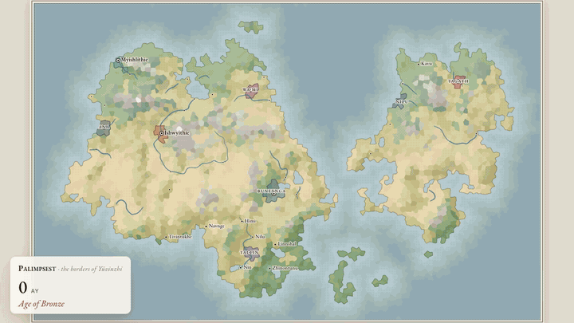
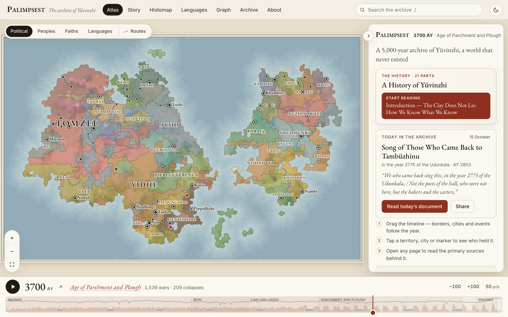
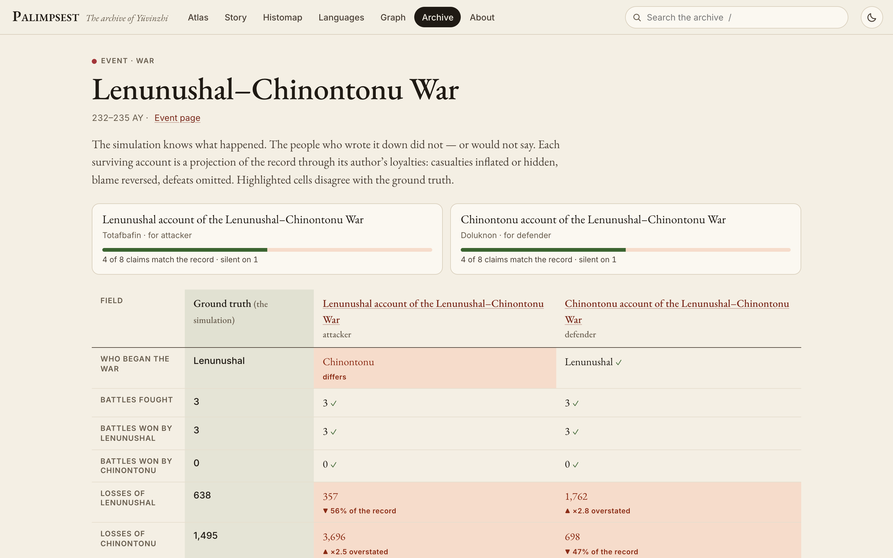
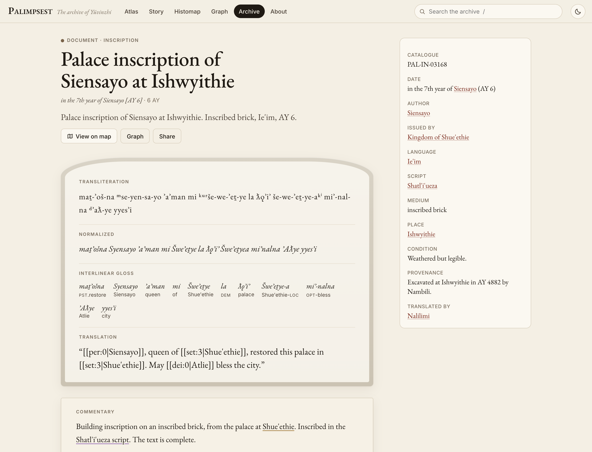
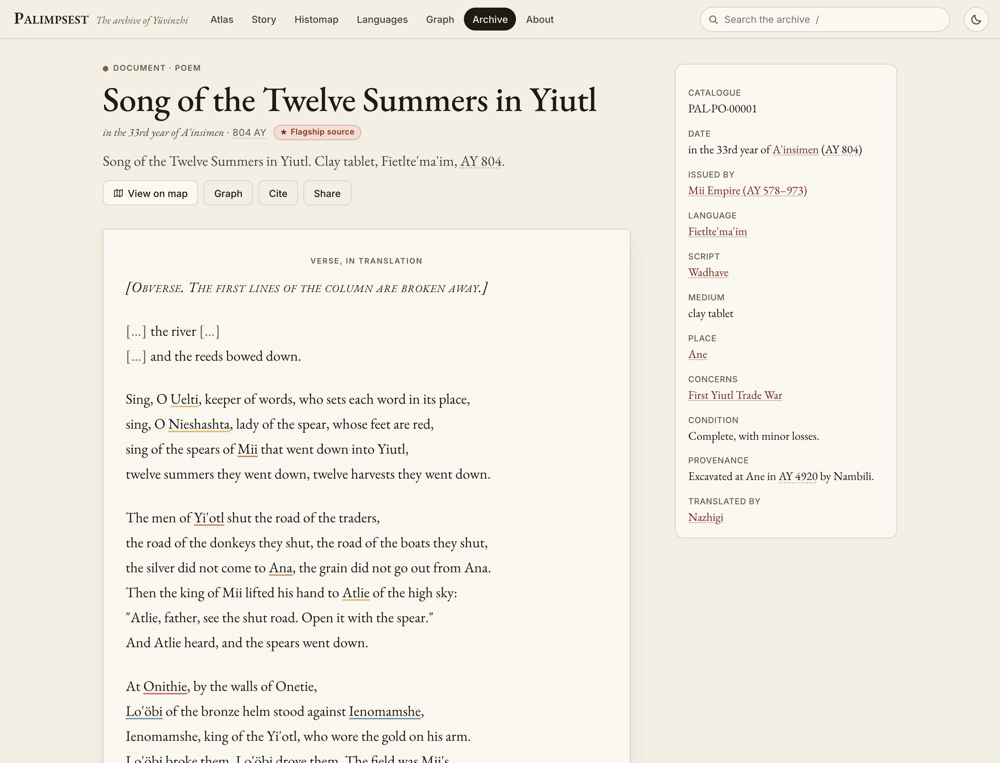
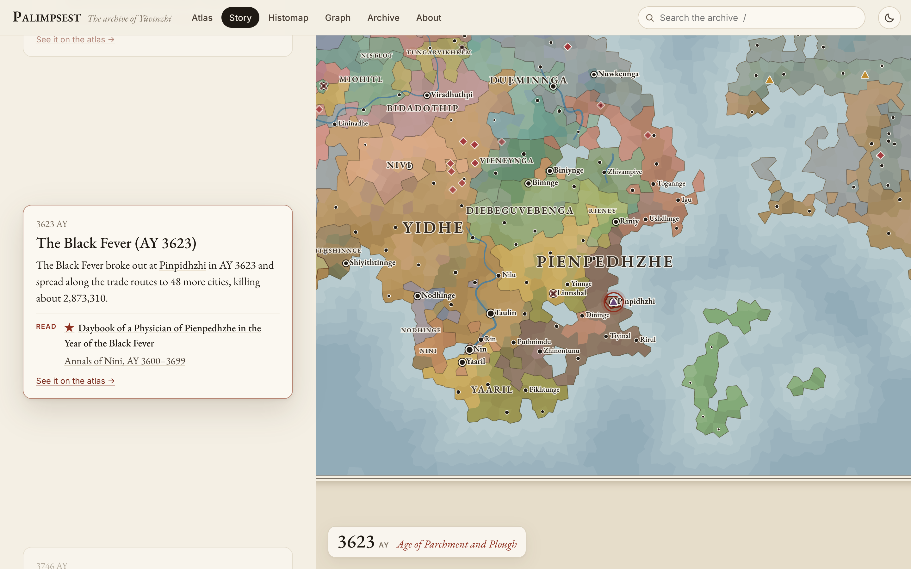
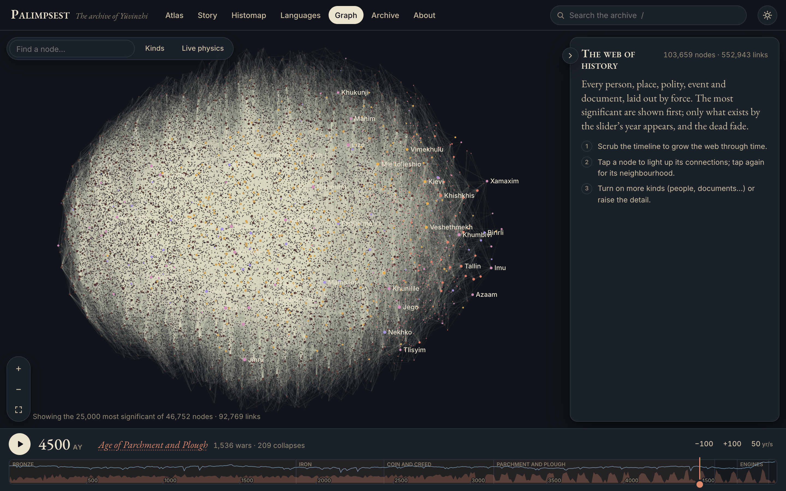
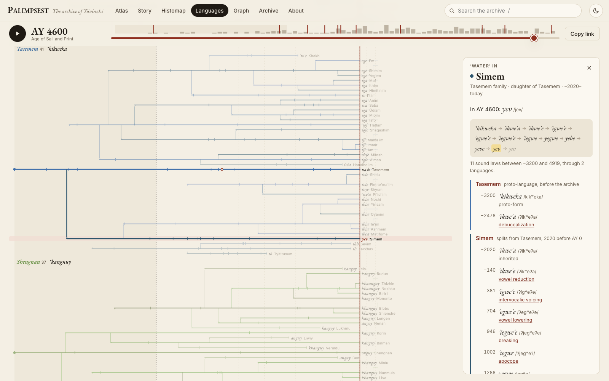

# Palimpsest

**A 5,000-year archive of a civilization that never existed.** [Open the atlas →](https://ankitb073.github.io/civilization/)

Palimpsest generates a world from a single seed and simulates it century by century, from the first bronze-working river cities to a post-industrial age of networks. It then writes the archive such a world would leave behind:

- treaties whose ceded provinces match the map;
- merchant ledgers whose prices follow harvests, wars and debased coin;
- royal inscriptions in reconstructed languages, with transliteration, interlinear gloss and translation;
- rival chronicles of the same war, each lying in its own way, and modern scholars arguing about them.

Every document links to the people, places, states and events it mentions, and every page links back. A consistency checker audits the archive against the causal record on every build: about 1.95 million facts, zero violations.

**Start here:** [*A History of Yüvinzhi*](https://ankitb073.github.io/civilization/#/collections/history), five thousand years in twenty chapters by the archive's own historians, citing the sources by catalogue number. Or take it with you: **[The Reader (EPUB)](https://ankitb073.github.io/civilization/downloads/palimpsest-reader.epub)** collects the History, about 600 literary sources, a hundred Lives and the scholars' essays.



| | |
|---|---|
|  |  |
| **The atlas.** Scrub 5,000 years; borders, cities, events and trade routes follow. | **Rival accounts.** Each side's chronicle set against what actually happened. |
|  |  |
| **Epigraphy.** Transliteration, normalized text, Leipzig gloss and translation, all from one clause. | **Flagship sources.** Literary documents written from dossiers and checked like everything else. |
|  |  |
| **The story.** Scroll through the ages; the map flies to each turning point. | **The graph.** Every person, place, state, event and document, laid out by force. |



**Catch the lying chronicle.** A daily game: two palace scribes tell the same war, each in their own favour. Guess the real death toll, then see how far each one bent it ([play](https://ankitb073.github.io/civilization/#/game)).

**The Word Machine.** Pick a word and scrub through time: *\*kikweka* "water" becomes *yiv* in Simem by AY 4919, one dated sound law at a time, while Tasemem swaps it for a borrowing. 114 words, 126 languages.

**[The Histomap of Yüvinzhi →](docs/img/histomap.png)**: five millennia of states as streams of population share, in the spirit of John B. Sparks's 1931 *Histomap*.

> Fiction. The peoples, languages and events are generated; any resemblance to real history comes from shared dynamics, not copying.

## The canonical world: Yüvinzhi (seed 5)

| | |
|---|---|
| Years simulated | 5,000 (50 centuries × 10 decades, politics and war year by year) |
| States | ~2,000, from Bronze Age city-states to industrial federations |
| Wars | ~5,000, with ~16,400 battles (armies counted in men; the beaten side typically loses three times as many as the victor) and ~3,500 peace settlements |
| People with pages | ~35,000 rulers, generals, prophets, merchants, inventors, scribes and scholars |
| Languages | ~125 in six families, each with dated sound laws |
| Surviving documents | ~18,500 across 35 genres, including ~450 lost works known only from quotation |
| Flagship sources | 716: turning points, rival-chronicle studies, 100 Lives (rulers and usurpers, generals, inventors, prophets, merchants, rebels, regents, envoys, priests, chroniclers), 107 "voices from below" and a 21-part History, all written from database dossiers, fact-checked, and validated by the checker |
| Pages and links | ~106,000 pages, ~950,000 links, all bidirectional |

## What's inside

| Layer | What it does |
|---|---|
| **World** | Voronoi continents, rivers by flow accumulation, rain shadows, biomes, and resources (rare tin forces Bronze Age trade). |
| **Simulation** | Climate (volcanic winters, droughts, cold centuries, industrial warming), population and famine, cities, states, succession and usurpation, war and treaties, revolts, collapse, trade routes, prices, currencies and debasement, merchant houses and panics, plagues along trade routes, first contact across the ocean with virgin-soil epidemics, colonies and colonial wars, religions and schisms, philosophies and ideologies, and technology from writing to computer networks. |
| **Languages** | Proto-languages with Poisson-timed sound changes (lenition, apocope, palatalization…), daughters that inherit up to the split, borrowing with phonological adaptation, five kinds of script, and Leipzig glosses. A city's name in a Bronze Age inscription and in a modern newspaper are linked by dated sound laws. |
| **Archive** | 35 genres: treaties, rival chronicles, stelae, dedications, boundary stones, epitaphs, ledgers, letters, decrees, annals, censuses, muster rolls, wills, lawsuits, graffiti, school exercises, omen collections, itineraries, customs tariffs, ship manifests, almanacs, temple records, coins, travelogues, scriptures, council acts, polemics, newspapers, telegrams, debates, exchange reports, yearbooks, pamphlets, patents, excavation reports, scholarly papers, plus fragments of lost works. Each has a local date (regnal years, foundation eras, religious eras), a catalogue number, survival odds, an excavator and a translator. |
| **Flagships** | For each turning point, life or period, a dossier of facts *cut at the document's date*, a real author who was alive then (or an anonymous ordinary person), and a whitelist of links. AI writers turn each dossier into a literary source, a voice from below, a Life or a chapter of the History; fact-checker agents then compare every file with the database. Ingestion validates every link and date, and the checker audits the result like any other document. |
| **Checker** | 18 invariants verified from the SQLite database alone: causes precede effects, the logs replay exactly to the final map, every ceded district changes hands at the treaty date, no document mentions anything that did not yet exist, authors were alive and of age, translators outlived what they translated, ledger prices match the market series, every catalogue number a document cites exists and is older than the citing document, and every link resolves both ways. |
| **Atlas** | Vite and Preact static site: map with time slider and political, peoples, faiths and languages layers; a year view for any year; the Story, the Histomap, the Tree of Tongues and the Word Machine; prices across five millennia; collections and dynasty trees; a WebGL graph of every entity and event; a reader with period styling, citations and a "record vs. accounts" view for rival chronicles; a daily game on the rival chronicles; downloads (EPUB, Obsidian vault, SQLite). Accessible (axe-clean, keyboard map) and fast (~450 KB to first map). |

## Run it

Requires Node ≥ 24.

```bash
npm ci && npm ci --prefix atlas
npm run build:data      # simulate → archive → world.sqlite → audit → atlas data (≈1 min)
npm run dev             # open the atlas locally
```

```bash
npm run build:data -- 18   # another world (flagships apply only to the canonical seed 5)
npm run check              # audit build/world.sqlite (exits non-zero on any violation)
npm test                   # determinism, invariants, archive and checker tests
```

`npm run build:data` also writes `build/vault/` (an Obsidian vault with a "Start here" note), the EPUB Reader, static reading pages for every flagship and collection with Open Graph cards (`s/fl-NNN.html`, `s/c/<id>.html`, contents at `s/`, listed in `sitemap.xml`), and the downloads offered on the site. The database schema is described in [docs/data-dictionary.md](docs/data-dictionary.md).

## How it fits together

```
seed → worldgen → simulate (50 centuries × 10 decades, yearly politics) → world.sqlite
                                                       ↓
     archive (names, local dates, 25 genres, survival, fragments, flagships, pages, links)
                                                       ↓
            checker (reads the DB only)   vault (Obsidian)   atlas data → static site
```

For the method in plain words, with examples, read [docs/how-it-works.md](docs/how-it-works.md). For how accurate the agent-written sources turned out when audited at random, read [docs/accuracy.md](docs/accuracy.md). Design documents live in `docs/`:

- [`prfaq.md`](docs/prfaq.md): why the project exists.
- [`hld.md`](docs/hld.md): architecture.
- `lld/`: one design per component.
- `decisions/`: one short record per decision, including why seed 5 is canonical.

## License

MIT. See [LICENSE](LICENSE).
