# Look-dev: how good can the streets of Pumi look?

Spike, 2026-10-16; integrated 2026-10-17 (decision 0033: its tiers, loading, late-afternoon sky and ground supersede the spike's where they differ). The user asked to "improve graphics to GTA 5 level", then: "as realistic as possible … increase quality to insane level". This page shows one direction, **grounded realism**, against the game as it is today, from the same viewpoints, with measured cost. It ends with a recommendation, quality tiers and what integrating it would take. Nothing in the game changes yet: the look is a module (`atlas/src/game/streets/look/`) applied at runtime in a dev harness.

**In short.**
- **It works, and the jump is large.** Grounded realism turns flat-lit coloured boxes into a sunlit mud-brick town:
  scanned plaster and brick, a photographed sky lighting everything, soft cascaded shadows, ambient occlusion,
  reflective water, haze, a filmic grade.
- **Desktop holds 60 fps.** It costs about 9 ms per frame end to end on this Mac, against 2.5 ms today.
- **Phones are the risk.** The phone tier costs five times today's GPU time. Projected from this Mac's GPU, that is
  about 30 fps on a mid-range phone, and a lighter phone tier about 60 fps. No real phone has been measured yet.
- **It is not GTA V,** and cannot be: the remaining gap is geometry and characters, not shading.
- **Recommendation:**
  - adopt it on three's `WebGPURenderer` with four tiers;
  - keep today's look where WebGPU is missing, because the WebGL2 backend takes 13–21 s to compile these shaders;
  - stream the textures after the first step;
  - make a hero district about 200 m across.
- **Characters** are the next gap to close.

## The contact sheets

Each sheet is the same viewpoint: the game today (left) and grounded realism (right). Desktop is 1440×900; the phone is 390×844 at DPR 2 (each look caps it: the game at 1.5, realism at 1.25).

**The market, at street level**

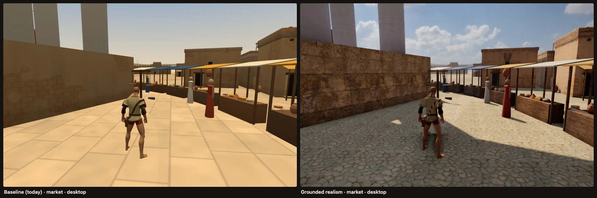

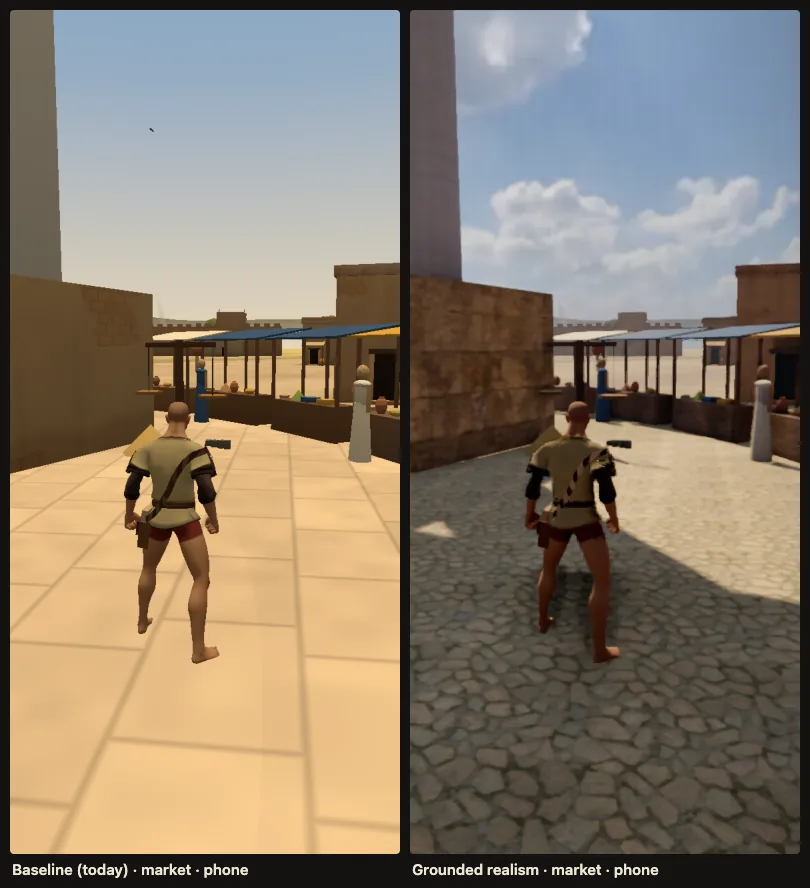

**A rooftop, toward the temple**

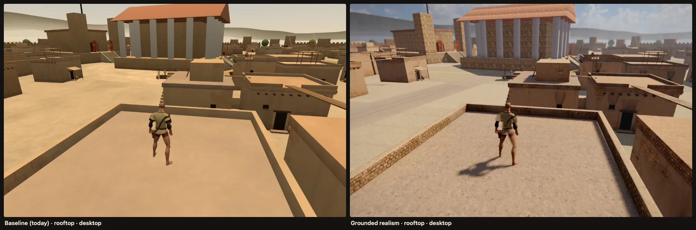

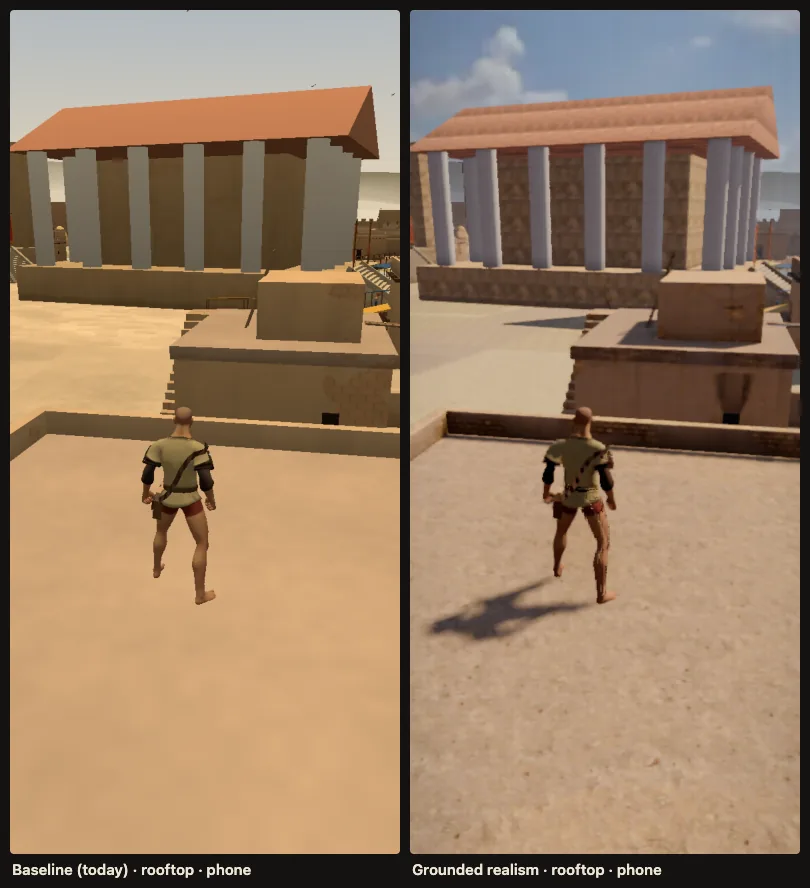

**The river and the bridge**

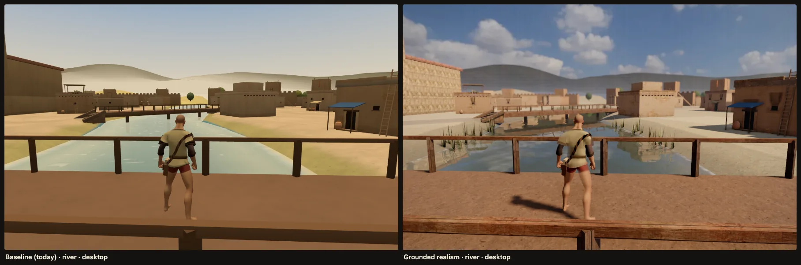

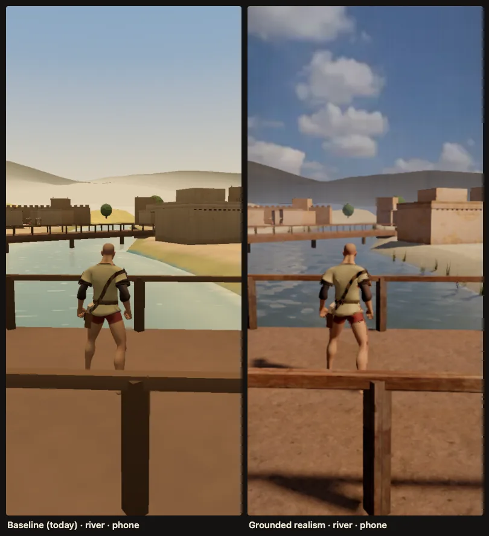

**A narrow lane**

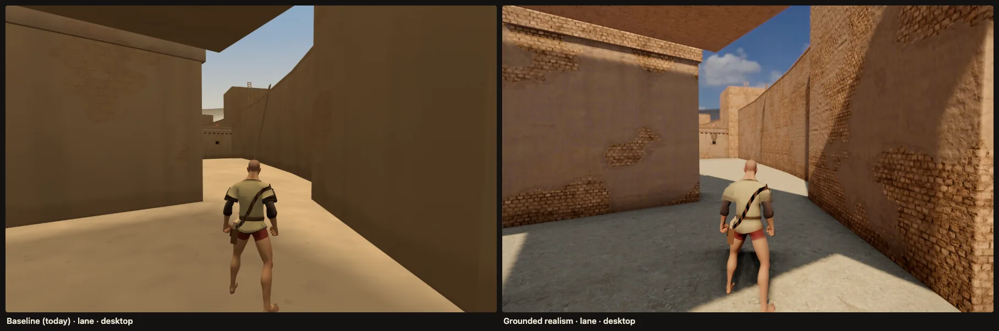

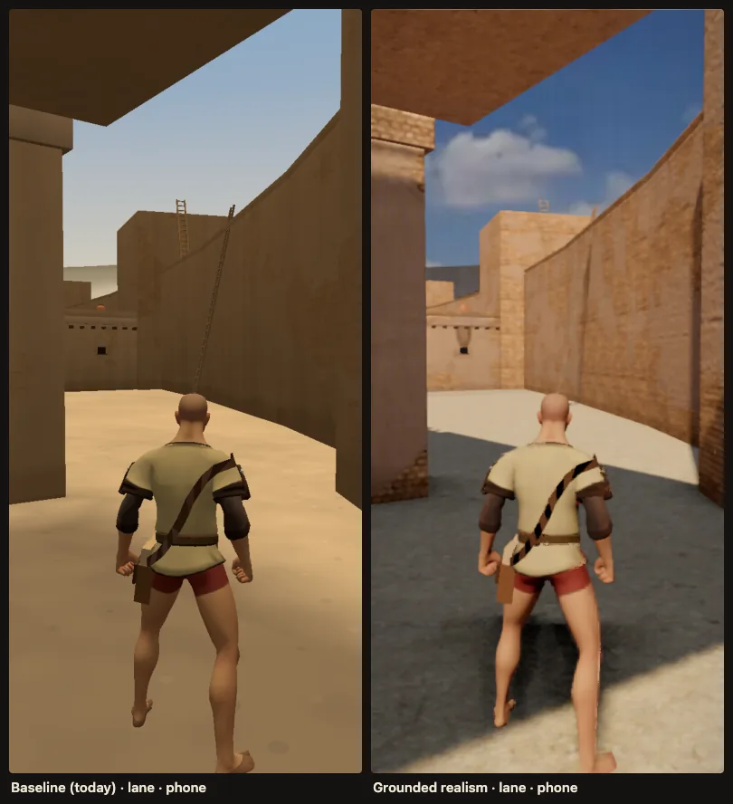

**The palace gate**

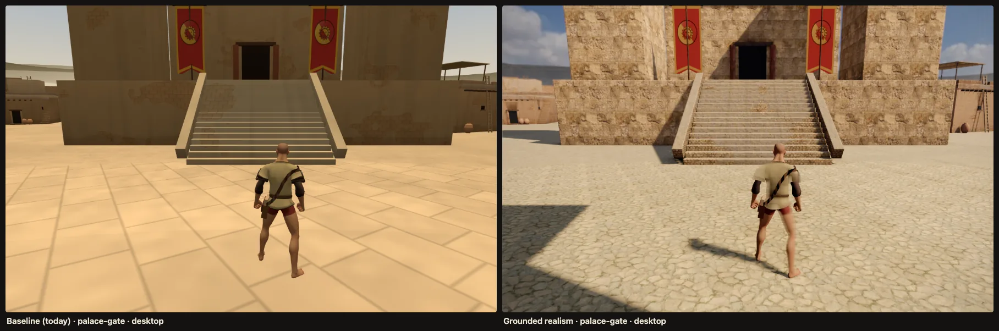

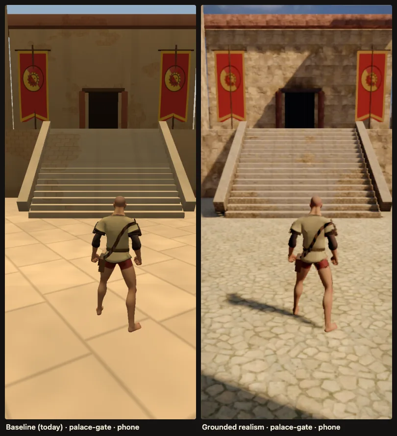

**A wall with a ladder, close (material detail)**

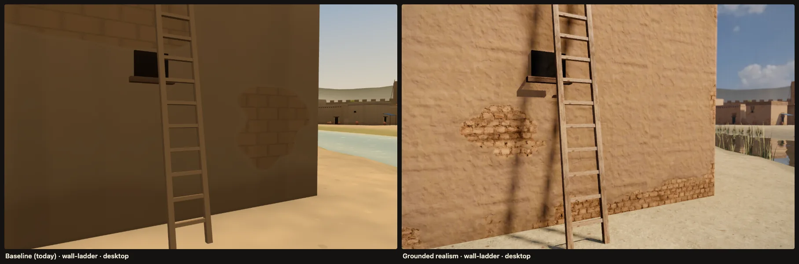

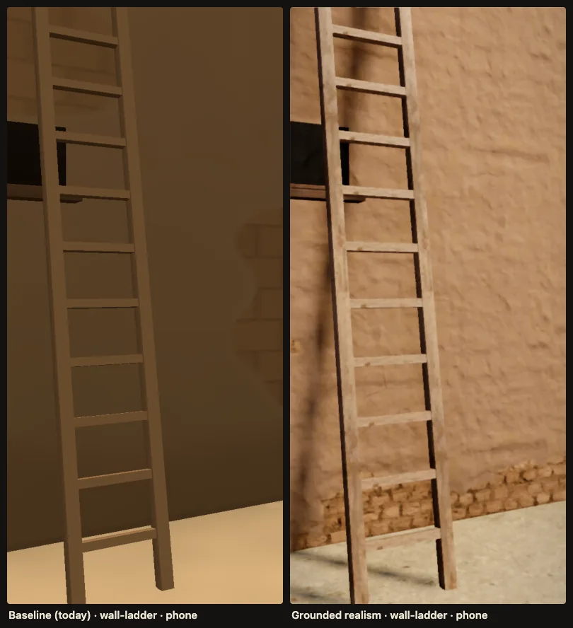

**The house of tablets**

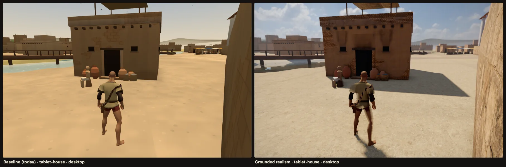

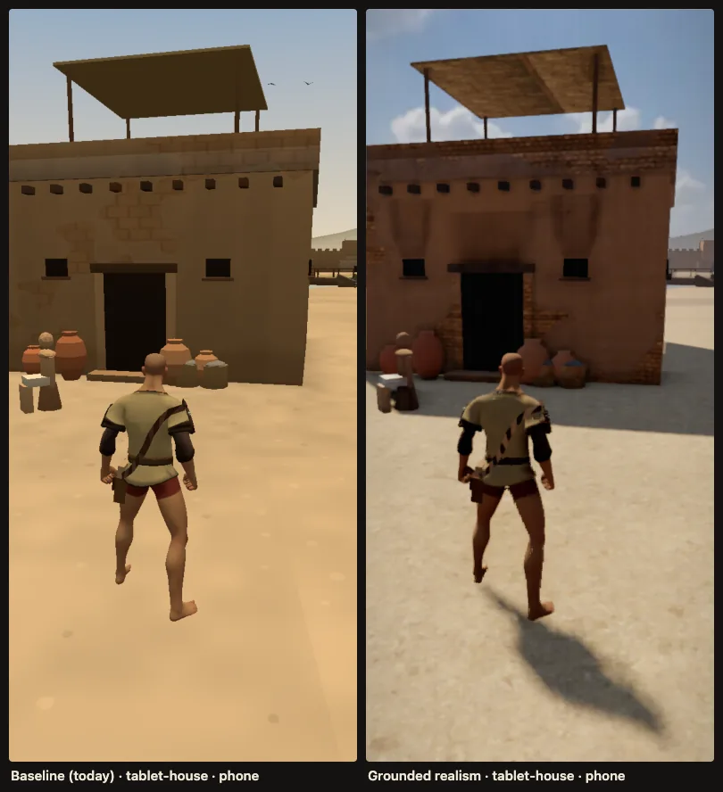

## What the realism look is

**Renderer.** three 0.185.1 `WebGPURenderer`: WebGPU where the browser has it, its own WebGL2 backend where not. Everything is written in TSL, three's node shading language, which compiles to WGSL or GLSL, so one code path serves both.

**Materials** (`look/materials.ts`), physically based, from eight CC0 Poly Haven scans:
- packed in KTX2 texture arrays (`look/textures.ts`): albedo in Basis ETC1S, and normal, roughness and height in Basis UASTC;
- the surfaces seen closest at 2K on desktop, the rest at 1K, everything at 512 on phones;
- no mesh needs UVs: each face is projected along its own axes;
- each scan is divided by its mean colour, so the record's colours (the city model's instance colours, the streets layer's vertex colours) still tint it.

| Surface | What it does |
|---|---|
| Walls | Mud plaster over mud brick (`clay_plaster`, `worn_brick_wall`), with parallax on the exposed brick. The plaster flakes in ragged patches, most at the foot (rising damp), the corners and the wall top. It also has: a shading bevel on every edge, a damp splashed foot, rain streaks under the top, hairline cracks, re-plastered patches, sun-bleached tops and dirtier bottoms. |
| Roofs | Packed mud (`dirt_floor`). |
| Monuments | Dressed stone (`large_sandstone_blocks_01`); whitewashed parts in lime plaster. |
| Ground | Packed earth, broken by a second, rotated sample. The temple square is irregular flagstones (`grassy_cobblestone`) with dust in the joints and parallax. The main roads have wheel ruts. Earth is damp by the water; the river bed is silt. |
| Props | Timber with its grain along each part's long side (`weathered_brown_planks`); cloth (`hessian_230`), reed (`reed_roof_04`), terracotta, bronze, grain, leaves. |
| Decals | Soot plumes above about 800 doors and windows, grime on the jambs, splashed feet (multiply-blended quads, drawn in the shader, no textures). |
| Reeds | Clumps along the river banks, swaying (one instanced draw). |

**Light and sky** (`look/sky.ts`, `look/index.ts`):
- **One CC0 HDRI** (`kloofendal_48d_partly_cloudy_puresky`, a sun 48° up among cumulus) serves twice:
  - its 1K HDR, with the sun clamped, is the image-based light (256×128 on phones);
  - its upper hemisphere at 4K, as an 8-bit WebP of 93 KB, is the visible sky, with an analytic sun disc and horizon haze.
- **Sun direction** is read from the HDR. The sky is turned so the sun stands where the game's sun did.
- **Lights:** a warm directional sun, plus a warm hemisphere "bounce" from the sunlit ground to light the shadows.
- **Shadows:** cascaded on desktop (3 × 2048²); one 2048² follow shadow over ±40 m on phones.

**Water** (`look/water.ts`):
- waves from a tileable slope map generated in code, scrolled along the flow;
- the river bed seen through it, refracted and absorbed by depth into silt;
- foam where it is shallow, and the sun's glint;
- Fresnel-weighted reflections: the town in a planar mirror at half resolution on desktop, the sky everywhere.

**Post** (`look/post.ts`, TSL `RenderPipeline`):

| Stage | Desktop | Phone |
|---|---|---|
| Pre-pass: normals, velocity, depth | ✓ | ✓ |
| GTAO, applied to indirect light only | half resolution, temporal | half of the pre-pass |
| Screen-space contact shadows toward the sun | ✓ | ✗ |
| Exponential height fog and aerial perspective, coloured by the sky and warmed toward the sun | ✓ | ✓ |
| Sun shafts | ✓ | ✗ |
| Anti-aliasing | TRAA | TAAU: drawn at 75%, reconstructed to full size |
| Depth of field (only the far distance) and camera motion blur | ✓ | ✗ |
| Bloom | ✓ | ✗ |
| Grade, then AgX tone mapping, then vignette and a trace of grain | ✓ | ✓ |

The chosen light and grade are `DEFAULT_TUNE` in `look/index.ts`: exposure 0.62, sun 7.5, sky light 0.6, contrast 1.2, saturation 1.18.

## The numbers

All measured with `atlas/scripts/lookdev.ts` on 2026-10-16, in Chromium with WebGPU on an **Apple M5 Max**.
- **Desktop:** 1440×900 at DPR 1.
- **Phone:** 390×844, its DPR capped by each look (the game at 1.5, realism at 1.25), with **4× CPU throttling**.
- **The phone runs on this Mac's GPU**, so its GPU figures are far too optimistic. A mid-range phone GPU is roughly a
  tenth as fast (see the projection below).
- **Frame interval:** a 10 s camera move from the market down the lane, past the house of tablets, to the palace
  gate. The display's 60 Hz caps it.
- **Frame cost:** the same path drawn frame by frame, each frame's GPU work waited for. It is free of vsync: CPU plus
  the GPU's tail.

**Desktop**

| Desktop, 1440×900 | Today (WebGLRenderer) | Realism (WebGPU) | Realism (WebGL2 fallback) |
|---|---|---|---|
| Frame interval, median / p95 | 16.7 / 18.1 ms | 16.7 / 18.2 ms | 16.7 / 18.2 ms |
| CPU per frame, median / p95 | 0.3 / 0.4 ms | 4.3 / 4.8 ms | 3.5 / 4.2 ms |
| Frame cost, median / p95 | 2.5 / 3.0 ms | 9.2 / 11.0 ms | 8.3 / 12.9 ms |
| GPU time, median | 1.2 ms (timer query) | 24.5 ms ¹ | 15.3 ms ¹ |
| Draw calls, median (max) | 64 (87) | 260 (337) | 260 (337) |
| Triangles, median (max) | 205k (258k) | 932k (1.10M) | 932k (1.10M) |
| Texture memory | 26 MB | 59 MB of arrays + 26 MB of the city's own maps + 25 MB sky ² | same |
| First frames (shader compile) | 0.1 s | 0.8 s warm, 4.3 s cold | **21 s** |
| Download added | — | 29.7 MB textures and skies; 230 KB JS and 260 KB transcoder (gzip) | same |

**Phone**

| Phone, 390×844, 4× CPU | Today | Realism (WebGPU, TAAU 75%) | Realism (WebGL2) | Phone-low (WebGPU, FXAA, no AO, DPR 1) |
|---|---|---|---|---|
| Frame interval, median / p95 | 16.6 / 18.4 ms | 16.7 / 18.4 ms | 16.7 / 18.2 ms | 16.7 / 18.4 ms |
| CPU per frame, median / p95 | 0.8 / 1.4 ms | 6.1 / 7.3 ms | 5.8 / 7.5 ms | 4.5 / 6.8 ms |
| Frame cost, median / p95 | 2.3 / 3.3 ms | 6.9 / 8.2 ms | 11.1 / 18.4 ms | 6.6 / 14.0 ms |
| GPU time on this Mac, median | 0.68 ms | 3.57 ms | 5.91 ms | 1.23 ms |
| **Projected GPU, mid-range phone (×10)** | **~7 ms: 60 fps** | **~36 ms: ~30 fps** | ~60 ms | **~12 ms: 60 fps** |
| Draw calls, median (max) | 46 (63) | 90 (122) | 90 (121) | 60 (76) |
| Triangles, median (max) | 163k (202k) | 344k (414k) ³ | 344k (414k) | 222k (255k) |
| Texture memory | 9.3 MB | 4.2 MB of arrays + 9.3 MB city maps + 6.3 MB sky | same | same |
| First frames (shader compile) | 0.09 s | 0.6 s warm, 3.4 s cold | **12.8 s** | 0.5 s |
| Download added | — | 2.8 MB (1.4 MB with ETC1S data ⁴); 230 KB JS and 260 KB transcoder | same | same |
| Slow 4G (1.6 Mbps, 150 ms) | — | textures in **28 s** (about 11 s with ETC1S and JS) | same | same |

¹ On WebGPU this is the sum of every pass's timestamps. The GPU overlaps passes, so the sum exceeds the frame. The
frame cost above is the reliable figure: realism holds 60 fps with room to spare on this Mac.

² The 4K sky is an 8-bit RGBA texture. As KTX2 it would take about 6 MB.

³ Over the HLD's 300k phone budget: the follow shadow draws the town a second time. The reeds (17k) and the shadow
radius are the knobs.

⁴ Measured: the phone data array at Basis ETC1S is 0.86 MB against 2.3 MB at UASTC. Normals are blockier; it is
untested by eye.

**Desktop on slow 4G** would take 5 minutes for the 2K set, which is why it streams. At 50 Mbps it takes about 5 s.

**The game's own load** on slow 4G is 13.7 s today (decision 0031). The look must load after the first step, not
before it.

## GTA V, honestly

**What closes the gap.** The things that make a frame read as a modern, expensive game are mostly lighting and
material response, and those a browser can now do:
- **Light:** a real sky in image-based lighting, a strong sun, and cascaded soft shadows.
- **Shadow detail:** ambient occlusion applied to indirect light only, contact shadows, and warm bounce light.
- **Materials:** scanned PBR with parallax.
- **Water:** reflection and refraction.
- **Atmosphere:** height fog and aerial perspective.
- **The camera:** temporal anti-aliasing and a filmic tone curve with a grade.

The sheets show the jump: from "flat-lit boxes" to "a sunlit place". On a desktop GPU this costs a few milliseconds.

**What it cannot close, and why.**
- **Geometry and authoring.** GTA V's streets are millions of hand-modelled, hand-dressed triangles. Every wall has
  thickness, trim, damage, clutter and hand-placed decals, from a team of hundreds over about five years (a reported
  $265 million with marketing). Ours is about 1,000 generated boxes. Textures cannot hide a perfectly straight
  edge or a door that is a black slab; only the modular kit being made in Blender can.
- **Characters and animation.** Faces, skin, hair, cloth and mocap animation are where GTA spends most. That is the
  biggest gap left after this look.
- **Global illumination at scale.** GTA bakes light probes over its whole map and adds dynamic time of day,
  volumetric clouds and screen-space reflections everywhere. We have one fixed sky, a fake bounce term and
  reflections only on the river. Three's SSGI node exists, but it costs too much for this budget.
- **Density.** Crowds, traffic and vegetation at GTA's density are CPU and draw-call budgets a browser tab does not
  have, least of all on a phone.
- **Phones.** A mid-range phone GPU is about a tenth of this Mac's. The phone tier keeps the lighting model and drops
  most of the post stack. Real phones are unmeasured (see the numbers).

**Where this lands.** On desktop, the image is in the range of a good mid-budget game of the late 2010s. It is closer
to a well-lit indie open world than to GTA V, mainly because of the geometry and the characters. On phones it is the
same scene with simpler light and post. It is still clearly better than today.

## WebGPU or WebGL

**Recommendation: WebGPURenderer, with TSL, everywhere.** It runs WebGPU where the browser has it (Chrome and Edge, and
Safari 26 on iPhone and Mac) and falls back to its own WebGL2 backend elsewhere, from the same code.

**Why not stay on WebGLRenderer?**
- Everything this look needs is a maintained TSL node in three 0.185.1, working on both backends: GTAO into indirect
  light, contact shadows, TRAA, TAAU upscaling, DOF, motion blur, bloom, cascaded shadows, planar reflections. On
  WebGLRenderer, half of these would have to be written and kept by us.
- three's development is now on the node side.

**The costs, measured:**
- **CPU per frame.** three's WebGPURenderer spends more CPU per draw than WebGLRenderer. Realism takes 4.3 ms per frame for 260 draws on desktop, against 0.3 ms for today's 64; on the phone tier it takes 6.1 ms at 4× throttle for 90 draws. Draw-call count matters more there.
- **Shader compile time.** The first frames take 0.6–0.8 s with a warm shader cache and 3.4–4.3 s cold on WebGPU. On the WebGL2 backend (GLSL through ANGLE) it takes **13–21 s**, which rules that backend out for this look as built. This must happen behind the loading screen
  (`compileAsync`, as the harness does).
- **About 230 KB more JavaScript** (gzip) over three's shared core, for the renderer and node system (185 KB) and the
  post nodes and look code. Today's WebGL renderer part is 83 KB.

**The porting cost of `onBeforeCompile`.** TSL ignores it, so every patched material must be rewritten as a node
material.
- **Already ported** by this module, for the streets scene only:
  - `world/materials.ts` (`mudSkin`, `groundSkin`);
  - the city model's ground shader (`three/city/model.ts`);
  - `world/water.ts`.
- **Left to port:** `world/life.ts`, the banners' wind and the birds' flap: two small vertex patches, about 40 lines
  of TSL. Until then they draw unpatched (still banners, still birds).
- **Other views are unaffected.** The city view, the Tablet House backdrop and the rest keep WebGLRenderer and their
  shaders; only the streets route changes renderer.

## The hero district

Measured on Pumi's plan. The walled town has a radius of 146 m; the city's ground runs to 265 m.

The places the first days' errands use lie within 54 m of one centre, about (−8, 8), between the temple square and the
palace:

| Place | Distance from the centre |
|---|---|
| The temple | 20 m |
| The market and the weigher's scale | 24 m |
| The bridge over the river | 36 m |
| The palace gate | 40 m |
| The house of tablets | 54 m |
| The well | 54 m |

| Radius from (−8, 8) | Houses (of 295) | Ladders (of 183) |
|---|---|---|
| 80 m | 41 | 18 |
| **100 m (recommended)** | **76** | **29** |
| 120 m | 125 | 53 |
| 119 m round (−46, −7), taking in the river gate | 138 | — |

**Recommendation.** A hero district **about 200 m across: a circle of 100 m round (−8, 8)**.
- **Inside:**
  - the temple square, the market, the palace platform and gate, and the house of tablets;
  - the river with its nearest bridge;
  - about a quarter of the houses.
- **Boundary:** street ends and rooftops, where the circle meets houses. The river stays inside.
- **Full detail inside:**
  - the streets layer's near detail;
  - the hero texture set, parallax, decals and reeds;
  - cascaded shadows;
  - the modular kit when it lands.
- **Outside, a backdrop** that still matches the record lot for lot:
  - the model's own boxes with the cheaper props material and no parallax or decals;
  - shadows only from the nearest cascade;
  - no near detail;
  - beyond the walls, the haze already does the rest.

**What it leaves out.** The river gate is 148 m away and the dyers' street and postern about 140 m, so day 4's errand
would leave the district. Either:
- widen the circle to 120 m: 125 houses, still within the phone budget measured here, since the whole city is drawn
  today; or
- make those streets a second, smaller hero pocket loaded for that errand.

## Recommendation and tiers

**Recommendation: adopt grounded realism**, on `WebGPURenderer`, in these tiers.

- Pick the tier from `navigator.gpu` and a short GPU probe at load.
- Lock phones at 30 fps on the phone tier.
- Use TAAU's render scale as dynamic resolution.

| Tier | Who | What | Measured cost (this Mac) |
|---|---|---|---|
| **Desktop** | Discrete and Apple-silicon desktops | 2K hero set and 1K props, parallax, 3 shadow cascades × 2048², GTAO, contact shadows, river mirror, TRAA, far DOF, motion blur, bloom, shafts; DPR ≤ 1.5 | frame cost 9.2 ms, 260 draws, about 30 MB download (streamed) |
| **Desktop-medium** (not built yet) | Integrated GPUs (M1, Iris Xe: about a sixth of this Mac) | 1K set, no mirror, no contact shadows, no DOF or motion blur, TAAU at 80% | unmeasured; aim for under 12 ms GPU |
| **Phone** | High-end phones with WebGPU (iPhone 15 Pro and later, recent flagships) | 512 set, 256 IBL, one 2048² follow shadow, GTAO, TAAU at 75%, no mirror, no bloom; DPR ≤ 1.25; 30 fps lock | GPU 3.6 ms here, about 36 ms projected |
| **Phone-low** | Mid-range phones with WebGPU (the default on phones) | as phone, but FXAA, no GTAO, DPR 1 | GPU 1.2 ms here, about 12 ms projected |
| **No WebGPU** | Older browsers | **today's look** on WebGLRenderer | as today |

**Cost of the recommendation:**
- about 230 KB of JavaScript and 260 KB of transcoder (gzip), fetched with the streets chunk;
- 1.4–2.8 MB of textures on phones and 30 MB on desktop, streamed after the first step;
- 4–6 ms more CPU per frame;
- 0.6–4 s of shader compile behind the loading screen;
- 4–5× the GPU time of today's look on the same tier.

What it buys is the sheets above.

## What integrating it would take

In order; each step ends playable and measured.

1. **Real devices first.** Run the harness on an iPhone 12–13 and a Galaxy A54 class phone, in Safari 26 and Chrome.
   - Record the GPU frame time with the phone tier and with phone-low.
   - Decide 60 or 30 fps per class, with TAAU's render scale as the dynamic-resolution knob.
   - This is the biggest unknown left: every phone number here comes from this Mac's GPU.
2. **Renderer swap behind a flag** (`?look=realism`). `game.ts`:
   - creates a `WebGPURenderer` and awaits `init()`;
   - draws with `look.render()` instead of `renderer.render`;
   - passes the camera and the runner to `look.update()` each frame;
   - takes the sun's offset from the look (today it is hard-coded at (−38, 62, 26)).

   `world.ts` lets the look own fog, sky and lights (the look already hides the sky dome and the hemisphere, and drops
   the fog). Rapier, input and errands are untouched.
3. **Surface tags in the kit.** Replace the dev hook (`look/surfaces.ts installKitTags`, which re-runs the kit's
   bucketing) with a `surface` option on `Kit.define`. `build()` then writes `aBox`, `aDim` and `aNrm`: about 15
   lines in `world/kit.ts`.
4. **Port the last patches.** `world/life.ts` banners and birds, to TSL.
5. **Streaming.**
   - The 512 set and the 256 IBL load with the city (about 3 MB).
   - The 1K and 2K sets stream after the first step.
   - Shaders compile behind the loading screen.
   - The 4K sky backdrop becomes KTX2 too: it is about 25 MB of GPU memory as RGBA8 today.
6. **Hero district.** Gate the near detail, parallax, decals and the hero set to the district. The backdrop gets the
   cheaper materials (one flag on the materials).
7. **The kit and the hero.**
   - Their glTF assets (metallic-roughness PBR) drop in: `look.adopt(object)` sets their shadows. The image light, AO,
     contact shadows, fog, AA and grade apply to them untouched.
   - The kit should ship KTX2 textures (`gltf-transform`, already chosen in the HLD).
   - Use the same physical scale and texel density as here: about 1 mm per texel at 2K on a 2 m tile.
8. **A decision record** (0033: renderer and look), the README and CLAUDE.md commands, and a P2 issue for each item
   under "cannot close" that the team chooses to pursue.

## What the characters need to match

In this light, the characters will carry the realism or break it. Today's runner (Quaternius, simple PBR) already
looks plausible in the shots. Next to scanned walls, though, its uniform skin and cloth read as plastic.

**What they need:**
- **PBR maps at 1–2K:** albedo without baked light, normal, roughness. Skin with a subsurface approximation: TSL has
  `MeshPhysicalNodeMaterial` with sheen and transmission, or a cheap wrap term as the leaves use here. Cloth with a
  weave normal map and sheen.
- **The same scale and lighting response** as the scene: metres, linear albedo 0.2–0.6, no emissive.
- **Budget.** A hero of 30–60k triangles with two LODs. Crowds of 2–5k triangles each, instanced, as the HLD plans.
- **Faces that avoid the uncanny valley.** At a third-person camera, well-shaded, slightly stylised faces read better
  than a failed photoreal one.

**Sources:**
- **MakeHuman (exported models are CC0)** gives proportionate, rigged bodies and faces. The "Bronze Age" clothing
  should be modelled in Blender: kilts and sheath gowns of linen and wool, as the figurine look specifies.
- **Blender** (the local MCP) can retarget the UAL and Mesh2Motion clips, bake AO, and export meshopt and KTX2 glTF.
- Skin, cloth and leather textures can come from Poly Haven (CC0), as the scene's do.

## Files and how to run it

Integrated into the game on 2026-10-17 (decision 0033); the look-dev harness and its driver are gone, and the game itself
is now what is measured.

- **Look module:** `atlas/src/game/streets/look/`
  - `tiers.ts`: the renderer and tier choice (WebGPU or not, a GPU probe, `?look=`, `?tier=`, the player's choice);
  - `index.ts`: the four tiers and `createRealism`; `governor.ts`: stepping a tier down when frames run slow;
  - `materials.ts`, `textures.ts` (texture slots, placeholders and streaming), `sky.ts`, `water.ts`, `dressing.ts`,
    `post.ts`;
  - `surfaces.ts`: what each part is made of (read from the world's kit tags; look-dev's mapping until they exist).
- **In the game:** `#/streets?look=classic|realism&tier=desktop|desktop-medium|phone|phone-low`; `&off=ao,sss,dof,mb,bloom,
  shafts,mirror,parallax` switches parts off; `&tune=exp:0.8,env:1` tunes the light and grade; `&hero=0|1` picks the
  runner's model; `&stats=1` shows the tier.
- **Screenshots, timing and sheets:** `npm --prefix atlas run build && node atlas/scripts/streets-look.ts [--only=desktop|phone]
  [--looks=classic,desktop,…] [--cold] [--net=4g] [--out=build/streets-look]`.
- **Assets:** `node atlas/scripts/lookdev-assets.ts fetch|build|skies`. It needs `basisu` (brew `basis_universal`, Apache-2.0),
  `cwebp` and `ffmpeg`. Sources go into `build/lookdev/src2k/`. Every file, author, URL and hash is in
  `atlas/public/game/streets/look/LICENSES.md`.
